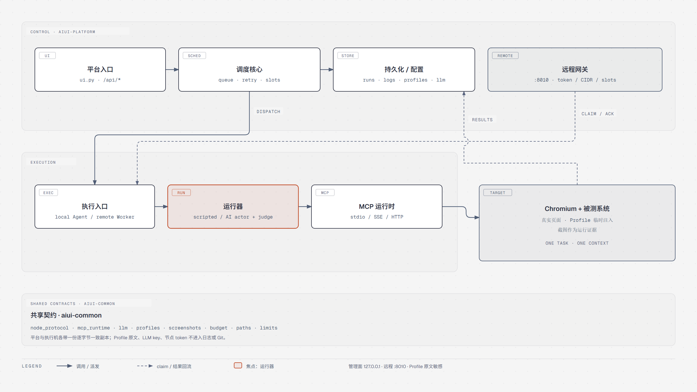
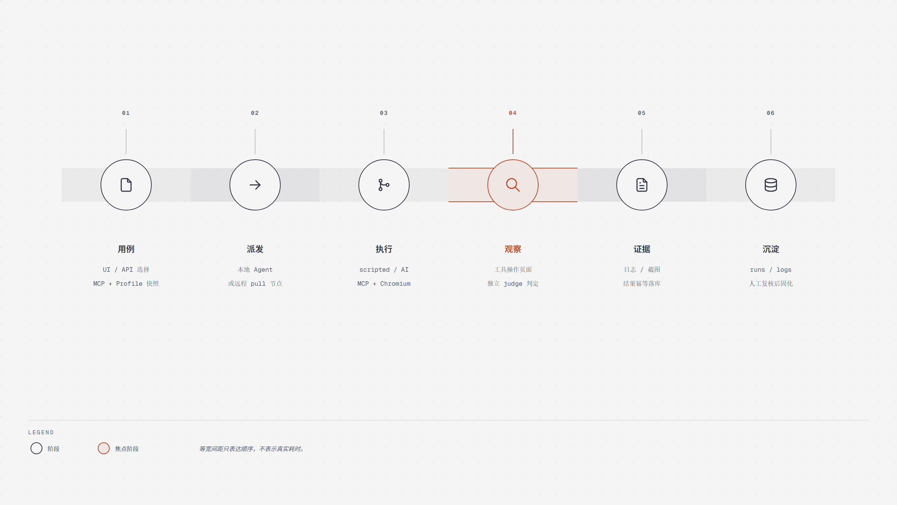
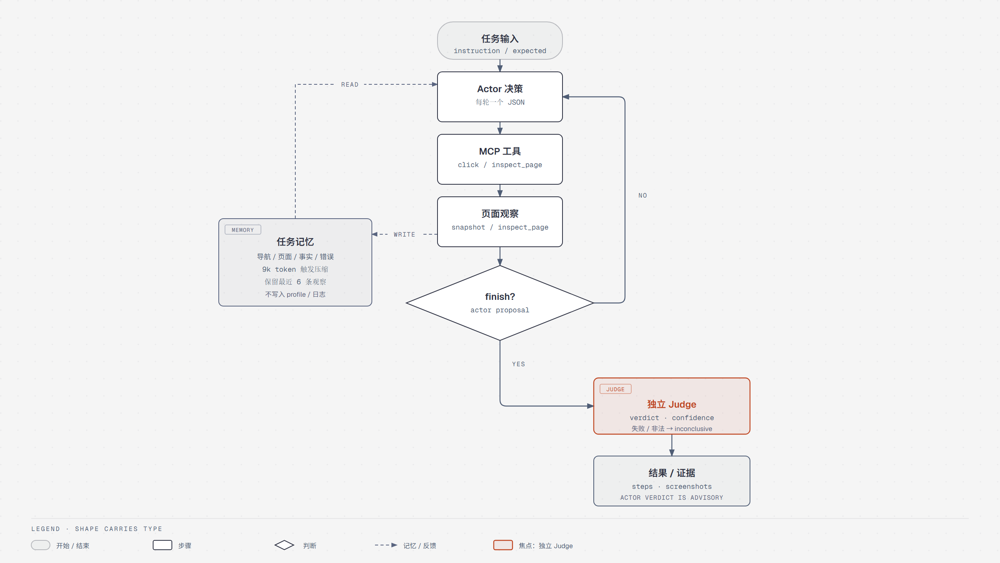
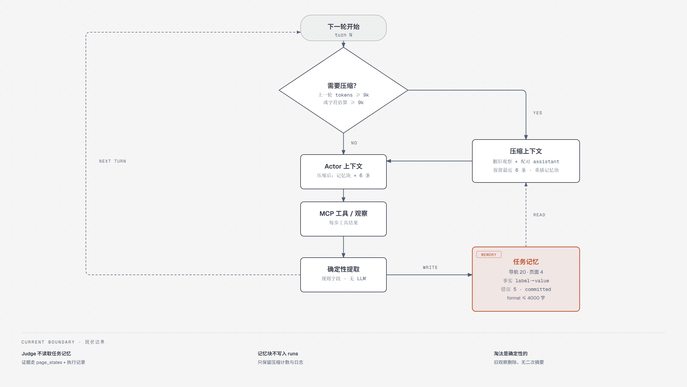
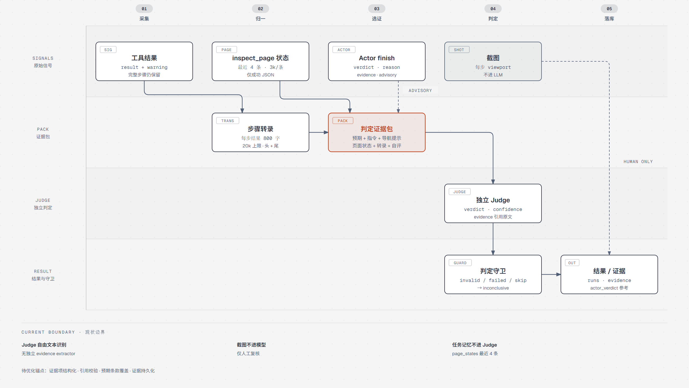

# AIUI 系统架构与核心流程

这里用三张总览图和两张专项图回答不同的问题：

1. **系统由哪些面组成？** —— 控制面、执行面、远程入口、共享契约、被测系统。
2. **一条用例怎样走完？** —— 从用例到证据的六个阶段。
3. **AI 模式怎样决策？** —— Actor 循环、任务记忆、独立 Judge。
4. **任务记忆怎样写入、压缩、注入？** —— 当前实现与边界。
5. **证据识别怎样从执行信号走到 verdict？** —— 当前证据包与判定守卫。

图采用 [diagram-design](https://github.com/cathrynlavery/diagram-design) 的编辑式设计系统：
纸色底、墨色结构、单一珊瑚焦点、正交连接线。本目录只保留 PNG 预览，
不再保留 HTML / SVG 源文件。

## 图片

| 图 | 回答的问题 | PNG |
|---|---|---|
| 系统架构 | 组件、职责边界、调用与回流 | [system-overview.png](system-overview.png) |
| 核心流水线 | 一条用例的六个阶段 | [core-pipeline.png](core-pipeline.png) |
| AI 执行 | Actor 循环与独立判定 | [ai-execution.png](ai-execution.png) |
| 任务记忆 | 写入、压缩、注入；Judge 边界 | [task-memory.png](task-memory.png) |
| 证据识别 | 执行信号 → 证据包 → Judge → 结果 | [evidence-recognition.png](evidence-recognition.png) |

### 系统架构

图里只有三种结构层和一个外部目标：

- **CONTROL · AIUI-PLATFORM**：平台入口（页面 / JSON API）、调度核心
  （优先级队列、min-load、重试、slot）、持久化与配置（SQLite、
  `runs` / `run_logs` / Profile / LLM / 预算）、远程网关（独立 `:8010`）。
- **EXECUTION**：执行入口（本地 Agent 或远程 Worker）、运行器（scripted
  或 AI actor + judge）、MCP 运行时（stdio / SSE / HTTP）。运行器是整张图
  的唯一珊瑚焦点，因为它同时承接控制面的任务和 AI 的判定语义。
- **SHARED CONTRACTS · AIUI-COMMON**：`node_protocol`、`mcp_runtime`、
  `llm`、`profiles`、`screenshots`、`budget`、`paths`、`limits`。平台和
  执行机各带一份逐字节一致的副本。
- **TARGET**：Chromium 里的真实页面，不是接口直调；一个任务对应一个
  browser context，Profile 只注入私有临时文件。

实线表示调用 / 派发，虚线表示 claim / 结果回流。远程网关与平台管理面是
两个监听器：管理面默认只绑 `127.0.0.1`，跨机执行只走远程网关。

### 核心流水线

六个阶段等宽排列，等宽只表达顺序，不表示真实耗时：

1. **用例**：UI/API 选择，生成 MCP + Profile + 预算快照。
2. **派发**：本地 Agent 或远程 pull 节点领取；派发快照不随配置编辑漂移。
3. **执行**：一个任务一个 asyncio / MCP session / Chromium。
4. **观察**：工具操作页面；scripted 用断言，AI 用观察 + 独立 judge。
   这是唯一焦点阶段——测试质量在这里决定，而不是在提交时决定。
5. **证据**：日志先 flush 再回结果；截图、Profile 摘要、幂等结果。
6. **沉淀**：`runs` / `run_logs` 持久化；人工复核后再冻结为 scripted 用例。

关键约束：结果只在任务 `running` 时接受；AI verdict 不消耗重试；截图是
证据，不参与 passed / failed 判定；副作用用例必须 `max_retry=0`。

### AI 执行

- **Actor** 每轮只输出一个决策 JSON：一个工具调用，或 `finish`。工具目录来自
  当次 MCP 的 `list_tools`，不调用目录外的工具。
- **页面观察**把 URL、标题、表单（含 selector）、表格、消息等写入
  **任务记忆**。记忆按真实 `prompt_tokens` 触发压缩（约 9k），保留导航、
  页面、事实、错误，最近 6 条观察保持原文；它不是完整对话的替代品。
- `finish` 只是 **actor 的提议**。另一个独立 Judge 调用读取工具轨迹、页面
  状态和期望结果，给出 `verdict` / `confidence`。
- Judge 失败、跳过或返回非法 JSON 时，结果为 `inconclusive`，
  `confidence=0`；actor 的结论只保留在 `actor_verdict` 供人工复核。
- **结果 / 证据**保存 `steps`、截图和判定理由。`bug_suspected` 只提示人工
  复核，不自动提产品缺陷，也不自动重跑 AI。

### 任务记忆

这张图对应 `aiui-executor/aiui/agent/ai_executor.py` 的当前实现，不是目标态：

- **写入是确定性的，不调用 LLM**：每个工具返回后，`_update_task_memory`
  按工具名和结果更新字段；`inspect_page` 成功时才生成页面摘要。
- **字段有固定上限**：导航 20 条、页面 4 个、错误 5 条，表单值进 `facts`，
  提交/保存/删除类点击置 `committed`；格式化成 prompt 块后截到 4000 字。
- **压缩由真实 token 触发**：每轮开始前，上一轮 `prompt_tokens >= 9000`，
  或字符估算 `总字符 / 3 >= 9000` 时触发。压缩删除早期“工具 …”观察和
  配对的 assistant 消息，只保留最近 6 条，再插入新的【任务记忆】块，
  并把上一轮 token 计数清零。
- **Actor 读记忆，Judge 不读**：记忆块只进入 Actor 的对话上下文；判定器
  仍只拿 `page_states`（最近 4 条）、执行记录头/尾和执行者自评。
- **记忆本身不落库**：运行结果只保留 `observations_compacted`、
  `context_compactions`、`last_prompt_tokens`、`max_prompt_tokens` 等计数，
  以及日志。

图底的“现状边界”就是后续优化的入口：Judge 看不到记忆、记忆块不持久化、
淘汰是无二次摘要的确定性删除。

### 证据识别

这张图把“证据从哪里来、经过谁、在哪里被消费”拆成四条泳道：

- **SIGNALS**：工具结果、`inspect_page` 页面状态、Actor `finish` 自评、
  每步截图。截图只进运行结果，供人工复核，不进入模型。
- **PACK**：步骤转录（每步结果截 800 字，整体 20k 上限；超长时保留头 + 尾，
  且不丢 `__finish__`）和判定证据包（预期、指令、导航提示、页面状态、
  执行者自评）。
  证据包是整张图的珊瑚焦点，也是“证据识别”真正发生的位置。
- **JUDGE**：独立 Judge 输出 `verdict`、`confidence`、`reason`、`evidence`；
  prompt 要求 evidence 引用执行记录原文。
- **RESULT**：判定守卫处理 `failed` / `invalid` / `skipped`，统一降为
  `inconclusive`、`confidence=0`；没有页面观察时，即使 Judge 给出
  `passed` / `failed` 也会被降级。最终写入 runs 的还包含 `actor_verdict`
  和截图引用，后者只供人工复核。

当前没有独立的 evidence extractor。Judge 直接在自由文本上做识别，因此
证据项不结构化、引用未做程序校验、预期条款也没有逐条覆盖；这些是图底
“待优化锚点”的来源。

### 优化切入点（候选，尚未实现）

| 部分 | 当前行为 | 候选方向 |
|---|---|---|
| 任务记忆 | 规则提取，字段固定；Judge 不读 | 把 `facts` / `committed` / 页面摘要变成可引用的结构化证据；评估是否让 Judge 读取精简记忆 |
| 任务记忆 | 旧观察直接删除，只留格式化块 | 增加二次摘要或重要性评分；保留被删观察的证据索引 |
| 任务记忆 | 记忆块不落库 | 持久化记忆快照/差异，支持回放和误判分析 |
| 证据识别 | Judge 自由文本找证据 | 先做 evidence extractor：`{claim, quote, step, url, source}`，再交给 Judge |
| 证据识别 | evidence 字段未校验 | 对引用做原文/模糊匹配，校验来源步骤；不通过则降级或标记 |
| 证据识别 | 页面状态只取 `inspect_page` 最近 4 条 | 扩大来源到 `browser_find` / 可见文本/表格；按预期条款选择，而不是按时间窗口 |
| 证据识别 | 截图不进入模型 | 保留人工复核路径；如引入视觉，单独标注成本和准确性边界 |
| 证据识别 | 无预期条款覆盖 | 拆分 expected 为可核对的条目，输出覆盖矩阵和缺口 |

## 图片说明

- 本目录只保留 PNG 预览；HTML / SVG 源文件已移除，避免同一张图维护多种格式。
- 每张图按 1280×720 画布、2x 导出，适合 README / 文档 / 内部 wiki 展示。
- 五张图使用同一套编辑式视觉语言；每张只有一个珊瑚焦点：运行器、观察阶段、
  独立 Judge、任务记忆存储、判定证据包。
- 图片用于说明当前实现和优化边界，不是测试证据；具体行为以代码为准。
- 需要改图时，按对应章节的文字说明重新生成 PNG，并同步更新本页，不再恢复
  HTML / SVG 副本。
- 旧的 `build_diagrams.py`、`core-flows.*` 也已移除。
